# Which feature group predicts the label, and how well?

Generated by `core/run_feature_group_plots.py`; no number is typed by hand. Every feature-group model is gradient boosting (300 rounds, learning rate 0.05), trained on real-Finnish rows (2,332 texts) and graded on the 865 real-Finnish test texts. Each group is used alone, so the rows show what a group can do by itself; The rows are sorted by MAE. The two *fine-tuned BERT* rows are references, not gradient boosting on a feature group: they come from `bert_based/run_finetune.py` (BERT trained end to end on the texts; see `bert_based/reports/BERT_FINETUNE.md`).

## How to read the numbers

- **MAE, MSE, RMSE**: the average miss in label points, its mean square and its square root. In brackets: the same value as a share of the label range (5 points, labels 1 to 6; MSE divided by the square of it). 0 is perfect. RMSE punishes big misses more than MAE does.
- **corr**: Pearson correlation between the prediction and the true label; 1 is perfect, 0 means no relation.
- **Boxplot**: for each true label, the spread of the predictions (the box holds the middle half, the orange line is the median, circles are outliers). **Scatter**: one dot per test text, nudged sideways so they do not overlap; the dotted line is a perfect prediction. The test set has no texts with label 1, 2.5 or 4.5, so those slots are empty.

## What the groups are

- **surface**: the 7 length and parse features (sentence count, mean, max and standard deviation of sentence length; tree depth, distinct POS, sentence length from the old parse columns).
- **grammar-concept / grammar-topic**: the share of every grammar concept (268) or syllabus topic (133) in the text.
- **vocab-lemma / vocab-stem**: the share of the text's words in each frequency bin, by lemma (12) or stem (13), and the mean log frequency. **vocab only** is both (25).
- **surface + all grammar + all vocab**: surface, concepts, topics, and all vocab including the 11 word-form features (word length, distinct lemmas, compounds, suffix ratios).
- **fine-tuned BERT (full / LoRA)**: BERT trained on the texts themselves, all 125M weights (full) or about 0.3M small adapter weights (LoRA); no hand-made features. Same train and test texts.
- **BERT-embedding**: the 768 numbers of layer 5 of `TurkuNLP/bert-base-finnish-cased-v1`, the layer with the lowest miss for ridge regression on the test set (so slightly optimistic).

## Results (smaller miss is better)

| feature group | features | MAE | MSE | RMSE | corr |
|---|---|---|---|---|---|
| [fine-tuned BERT (full), reference](train_native/10_bert_finetuned_full.png) | the text itself | 0.136 (2.7%) | 0.094 (0.4%) | 0.306 (6.1%) | 0.975 |
| [surface + all grammar + all vocab](train_native/01_best_surface_grammar_vocab.png) | 444 | 0.268 (5.4%) | 0.229 (0.9%) | 0.478 (9.6%) | 0.938 |
| [fine-tuned BERT (LoRA), reference](train_native/11_bert_finetuned_lora.png) | the text itself | 0.291 (5.8%) | 0.223 (0.9%) | 0.472 (9.4%) | 0.940 |
| [BERT-embedding (layer 5)](train_native/09_bert_embedding.png) | 768 | 0.308 (6.2%) | 0.245 (1.0%) | 0.495 (9.9%) | 0.935 |
| [surface only](train_native/08_surface_only.png) | 7 | 0.340 (6.8%) | 0.340 (1.4%) | 0.583 (11.7%) | 0.906 |
| [grammar-concept only](train_native/02_grammar_concept_only.png) | 268 | 0.460 (9.2%) | 0.475 (1.9%) | 0.689 (13.8%) | 0.866 |
| [grammar only (concept + topic)](train_native/04_grammar_only.png) | 401 | 0.472 (9.4%) | 0.497 (2.0%) | 0.705 (14.1%) | 0.859 |
| [vocab only (lemma + stem)](train_native/07_vocab_only.png) | 25 | 0.679 (13.6%) | 0.845 (3.4%) | 0.919 (18.4%) | 0.745 |
| [vocab-lemma only](train_native/05_vocab_lemma_only.png) | 12 | 0.787 (15.7%) | 1.109 (4.4%) | 1.053 (21.1%) | 0.651 |
| [vocab-stem only](train_native/06_vocab_stem_only.png) | 13 | 0.869 (17.4%) | 1.213 (4.9%) | 1.101 (22.0%) | 0.604 |
| [grammar-topic only](train_native/03_grammar_topic_only.png) | 133 | 1.315 (26.3%) | 2.306 (9.2%) | 1.519 (30.4%) | -0.121 |

## Figures

### fine-tuned BERT (full), reference

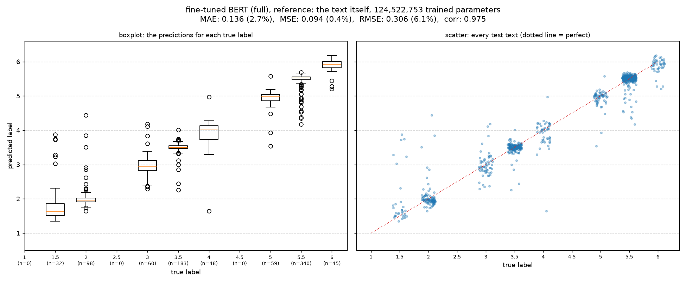

### surface + all grammar + all vocab

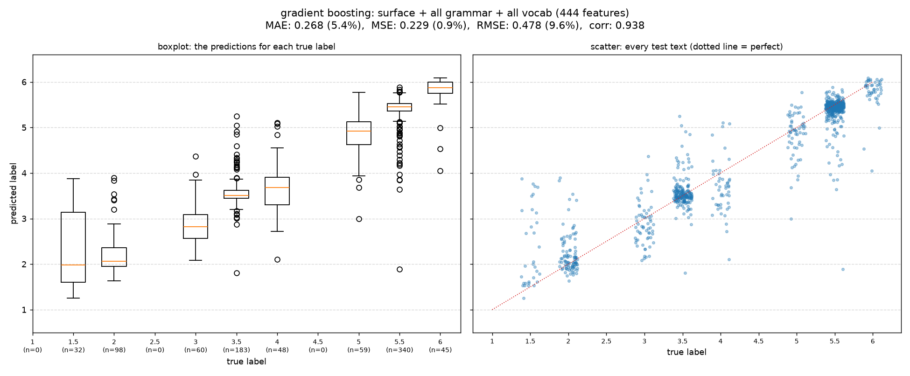

### fine-tuned BERT (LoRA), reference

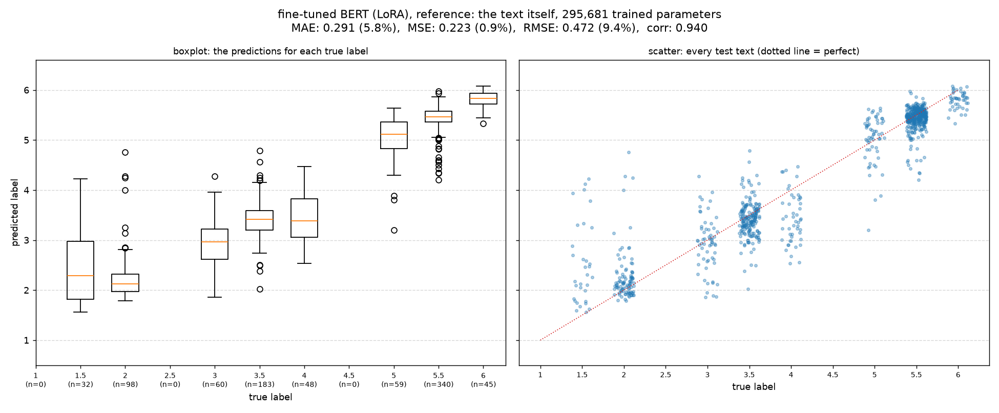

### BERT-embedding (layer 5)

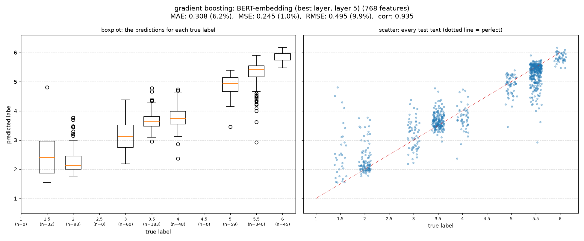

### surface only

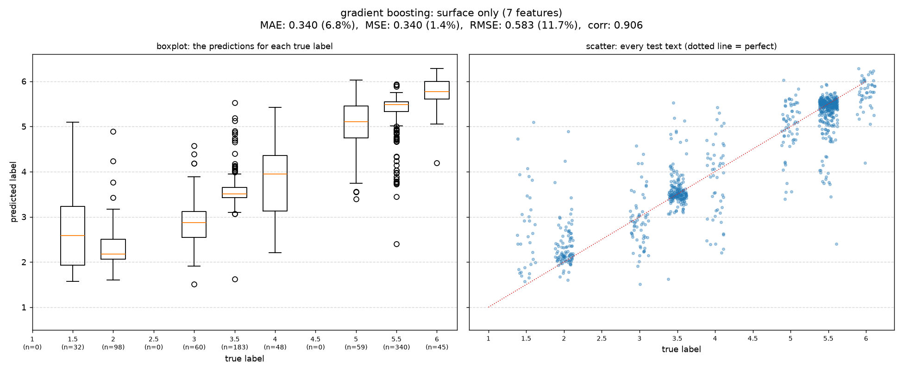

### grammar-concept only

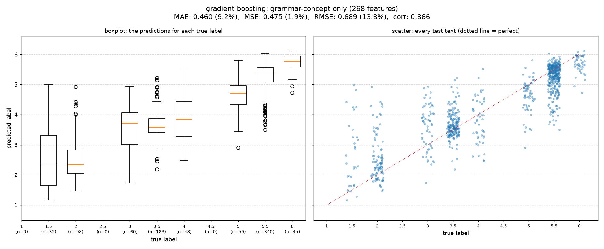

### grammar only (concept + topic)

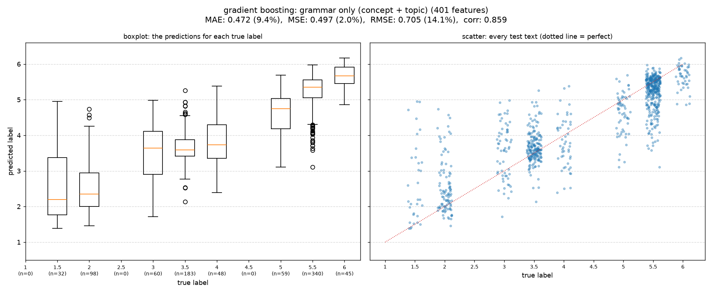

### vocab only (lemma + stem)

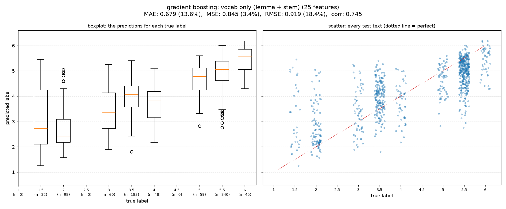

### vocab-lemma only

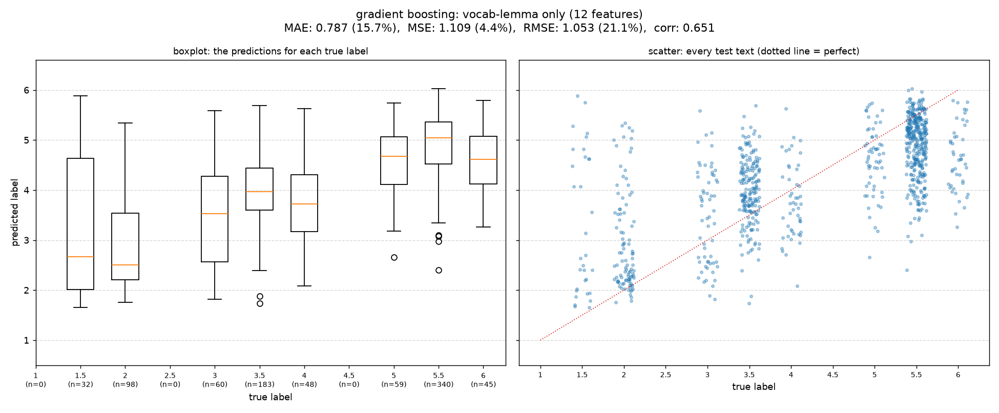

### vocab-stem only

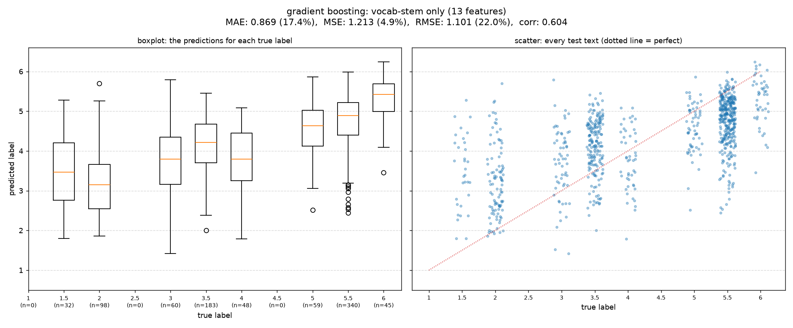

### grammar-topic only

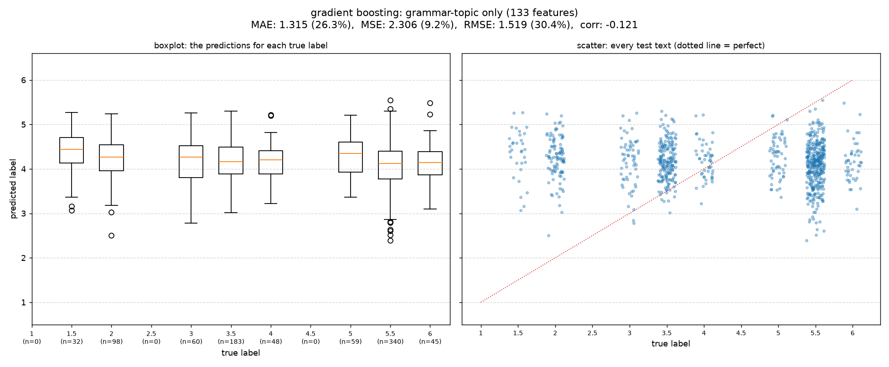

## Reproduce

```
python core/run_feature_group_plots.py
```
