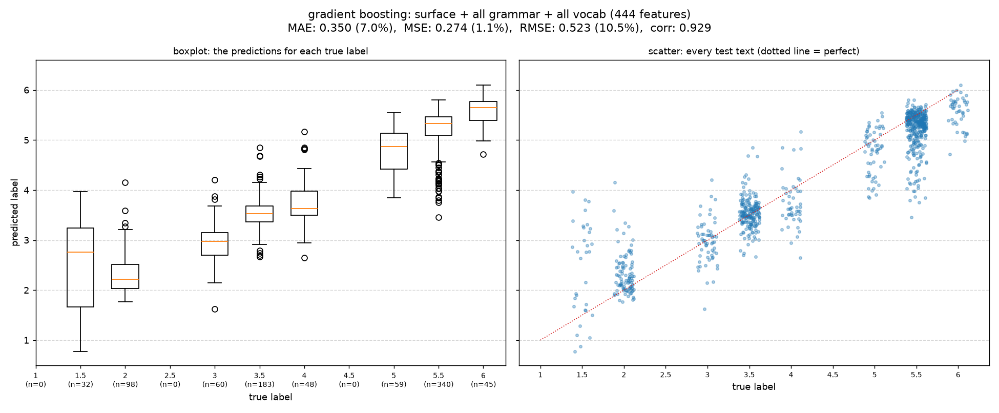
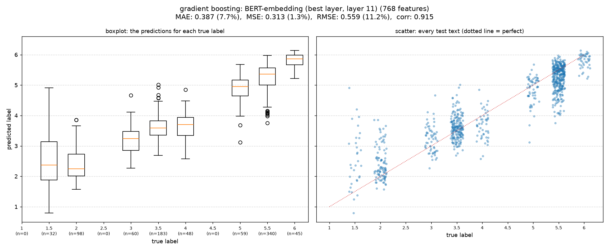
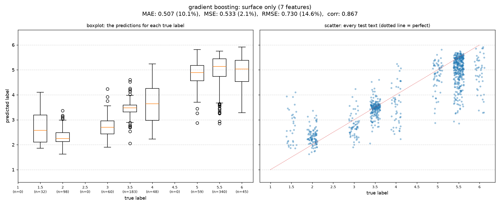
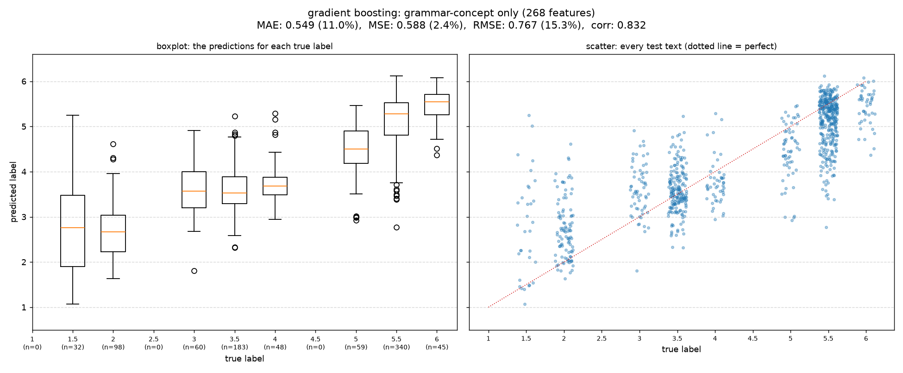
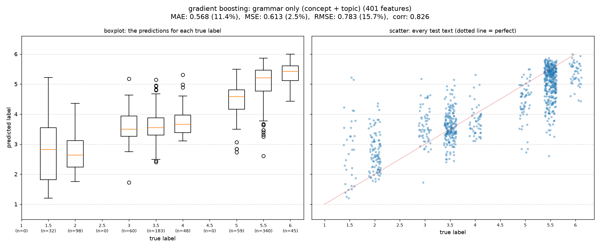
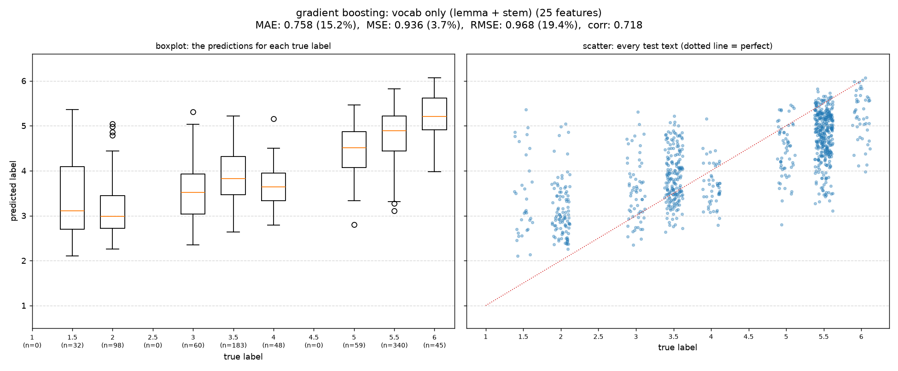
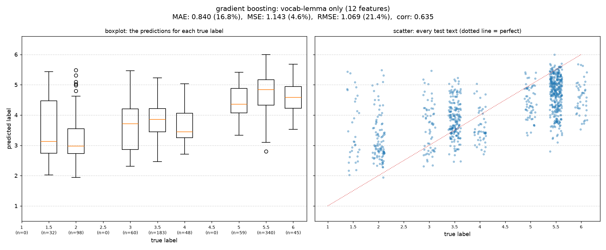
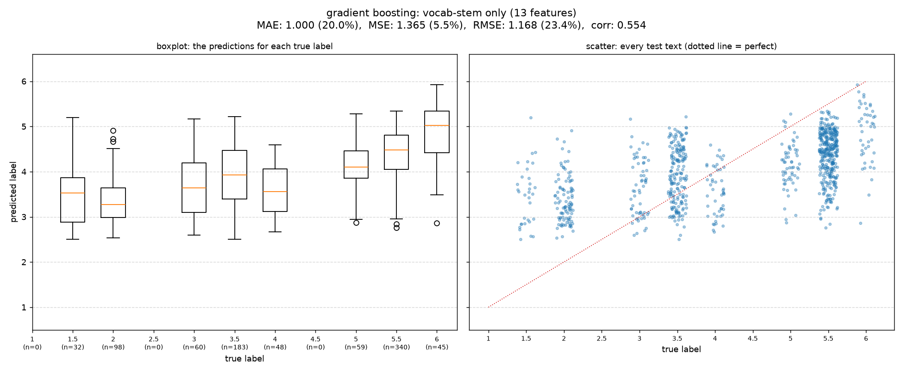
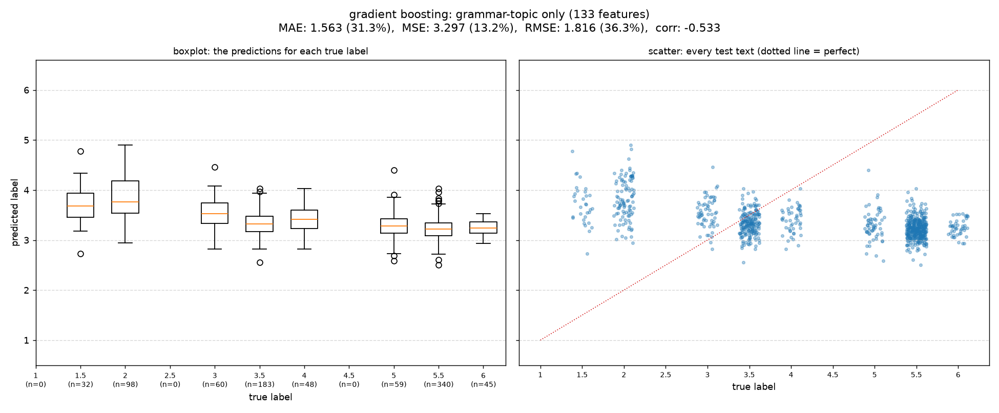

# Which feature group predicts the label, and how well?

Generated by `core/run_feature_group_plots.py`; no number is typed by hand. Every feature-group model is gradient boosting (300 rounds, learning rate 0.05), trained on all rows (8,293 texts) and graded on the 865 real-Finnish test texts. Each group is used alone, so the rows show what a group can do by itself; The rows are sorted by MAE. The two *fine-tuned BERT* rows are references, not gradient boosting on a feature group: they come from `bert_based/run_finetune.py` (BERT trained end to end on the texts; see `bert_based/reports/BERT_FINETUNE.md`).

## How to read the numbers

- **MAE, MSE, RMSE**: the average miss in label points, its mean square and its square root. In brackets: the same value as a share of the label range (5 points, labels 1 to 6; MSE divided by the square of it). 0 is perfect. RMSE punishes big misses more than MAE does.
- **corr**: Pearson correlation between the prediction and the true label; 1 is perfect, 0 means no relation.
- **Boxplot**: for each true label, the spread of the predictions (the box holds the middle half, the orange line is the median, circles are outliers). **Scatter**: one dot per test text, nudged sideways so they do not overlap; the dotted line is a perfect prediction. The test set has no texts with label 1, 2.5 or 4.5, so those slots are empty.

## What the groups are

- **surface**: the 7 length and parse features (sentence count, mean, max and standard deviation of sentence length; tree depth, distinct POS, sentence length from the old parse columns).
- **grammar-concept / grammar-topic**: the share of every grammar concept (268) or syllabus topic (133) in the text.
- **vocab-lemma / vocab-stem**: the share of the text's words in each frequency bin, by lemma (12) or stem (13), and the mean log frequency. **vocab only** is both (25).
- **surface + all grammar + all vocab**: surface, concepts, topics, and all vocab including the 11 word-form features (word length, distinct lemmas, compounds, suffix ratios).
- **fine-tuned BERT (full / LoRA)**: BERT trained on the texts themselves, all 125M weights (full) or about 0.3M small adapter weights (LoRA); no hand-made features. Same train and test texts.
- **BERT-embedding**: the 768 numbers of layer 11 of `TurkuNLP/bert-base-finnish-cased-v1`, the layer with the lowest miss for ridge regression on the test set (so slightly optimistic).

## Results (smaller miss is better)

| feature group | features | MAE | MSE | RMSE | corr |
|---|---|---|---|---|---|
| [surface + all grammar + all vocab](train_all/01_best_surface_grammar_vocab.png) | 444 | 0.350 (7.0%) | 0.274 (1.1%) | 0.523 (10.5%) | 0.929 |
| [BERT-embedding (layer 11)](train_all/09_bert_embedding.png) | 768 | 0.387 (7.7%) | 0.313 (1.3%) | 0.559 (11.2%) | 0.915 |
| [surface only](train_all/08_surface_only.png) | 7 | 0.507 (10.1%) | 0.533 (2.1%) | 0.730 (14.6%) | 0.867 |
| [grammar-concept only](train_all/02_grammar_concept_only.png) | 268 | 0.549 (11.0%) | 0.588 (2.4%) | 0.767 (15.3%) | 0.832 |
| [grammar only (concept + topic)](train_all/04_grammar_only.png) | 401 | 0.568 (11.4%) | 0.613 (2.5%) | 0.783 (15.7%) | 0.826 |
| [vocab only (lemma + stem)](train_all/07_vocab_only.png) | 25 | 0.758 (15.2%) | 0.936 (3.7%) | 0.968 (19.4%) | 0.718 |
| [vocab-lemma only](train_all/05_vocab_lemma_only.png) | 12 | 0.840 (16.8%) | 1.143 (4.6%) | 1.069 (21.4%) | 0.635 |
| [vocab-stem only](train_all/06_vocab_stem_only.png) | 13 | 1.000 (20.0%) | 1.365 (5.5%) | 1.168 (23.4%) | 0.554 |
| [grammar-topic only](train_all/03_grammar_topic_only.png) | 133 | 1.563 (31.3%) | 3.297 (13.2%) | 1.816 (36.3%) | -0.533 |

## Figures

### surface + all grammar + all vocab



### BERT-embedding (layer 11)



### surface only



### grammar-concept only



### grammar only (concept + topic)



### vocab only (lemma + stem)



### vocab-lemma only



### vocab-stem only



### grammar-topic only



## Reproduce

```
python core/run_feature_group_plots.py --train train_all
```
