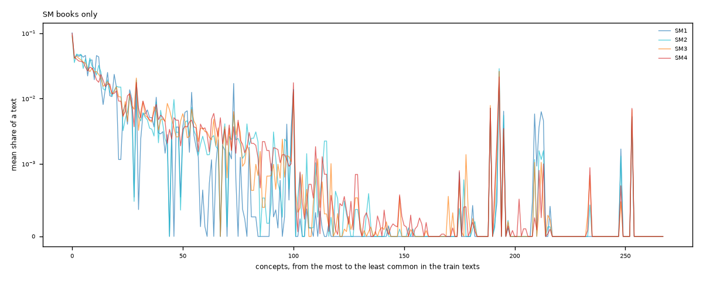
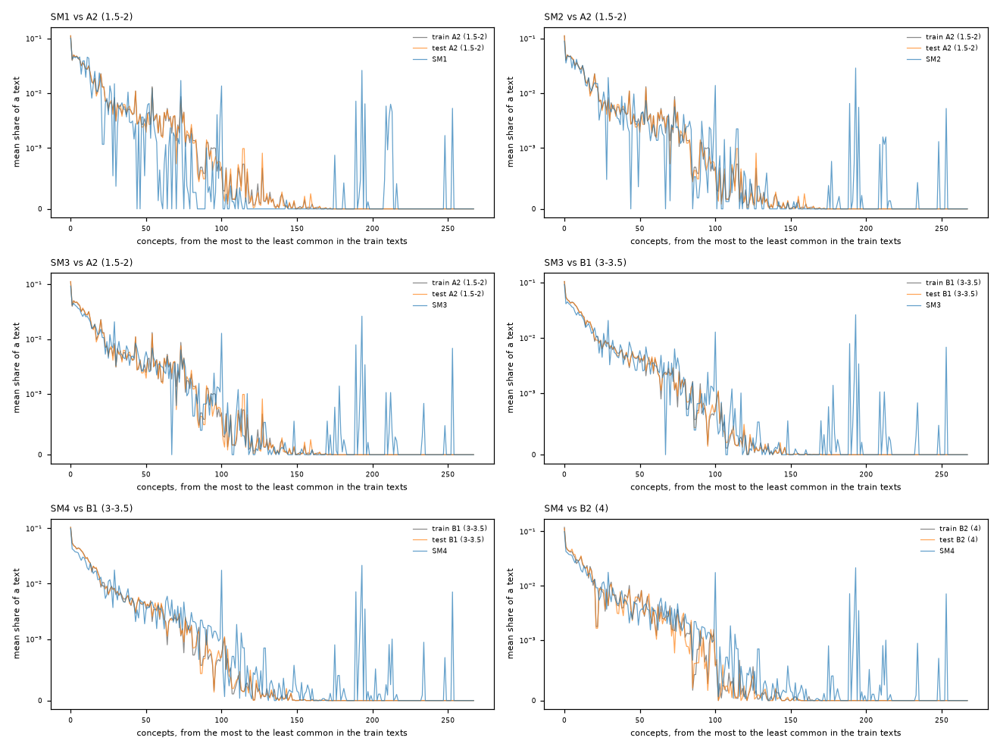

# Grammar concepts: mean share of each of the 268 concepts, SM books

The 268 concepts on the x axis, ordered from the most to the least common in the train texts (the same order in every plot); the y axis is the mean share of a text's concept occurrences (log-like scale, so that the rare concepts are visible). If the lines of two groups lie on top of each other, the two groups use the grammar alike.

## SM books only

## Each SM book against the train and test texts of the corresponding level

Six comparisons from the three training levels that the books can match (our labels start at A2, so SM1 has no A1 reference; C1 and C2 have no SM counterpart).

