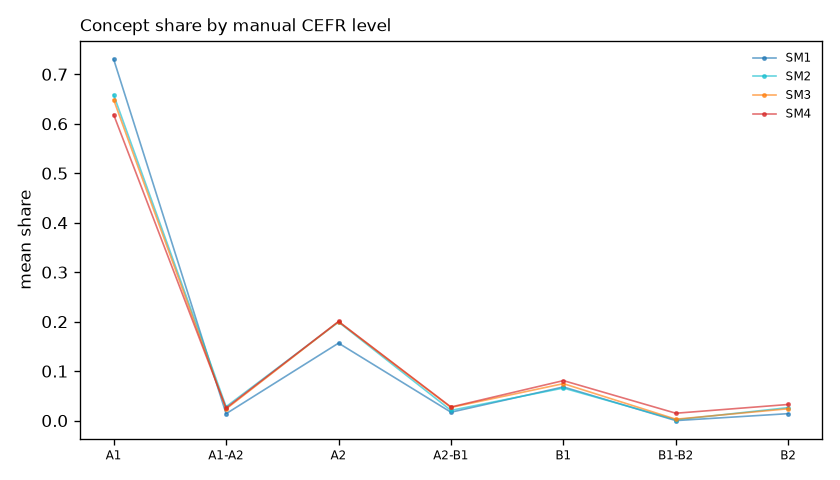
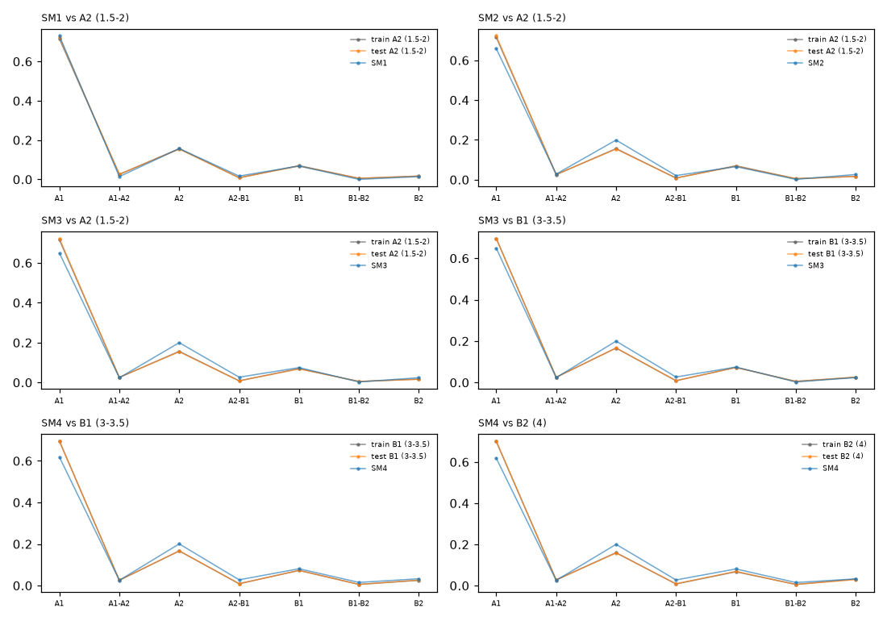

# Grammar concepts by manual CEFR level: the SM books

Mean share of the levelled concept occurrences of a text at each manual CEFR level (Revita's levels; concepts without a level are not counted).

## SM books only

## Each SM book against the train and test texts of the corresponding level

Six comparisons from the three training levels that the books can match (our labels start at A2, so SM1 has no A1 reference; C1 and C2 have no SM counterpart).

