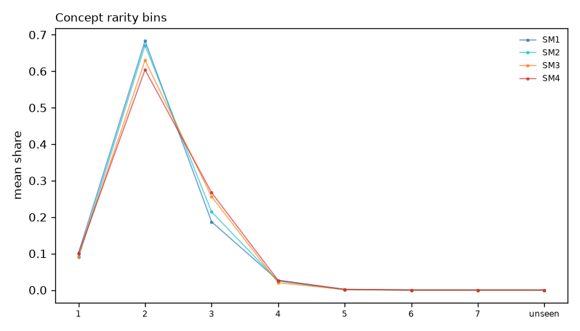
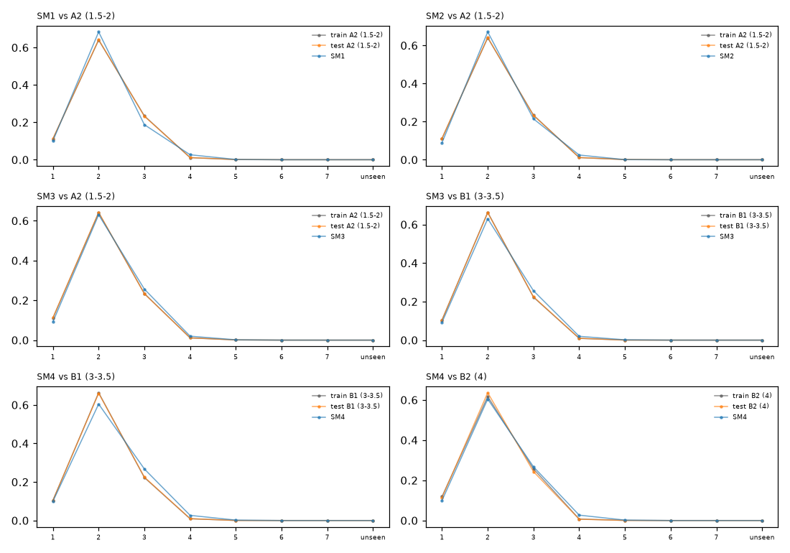

# Grammar concept rarity: the SM books

Mean share of a text's concept occurrences in each rarity bin (bin 1 = most common in Revita's 10,221 stories, bin 7 = rarest) and the share of concepts never seen there. The mean IDF is left out because it is on another scale.

## SM books only

## Each SM book against the train and test texts of the corresponding level

Six comparisons from the three training levels that the books can match (our labels start at A2, so SM1 has no A1 reference; C1 and C2 have no SM counterpart).

