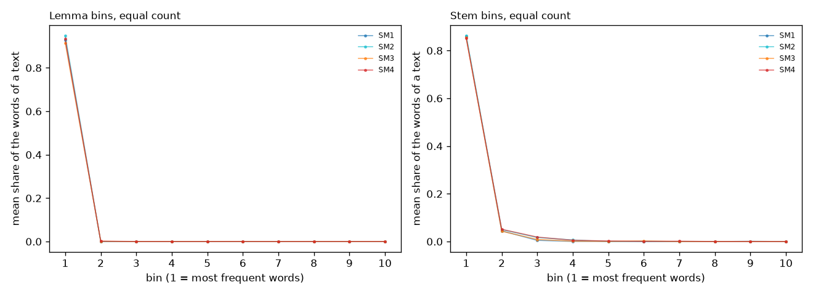
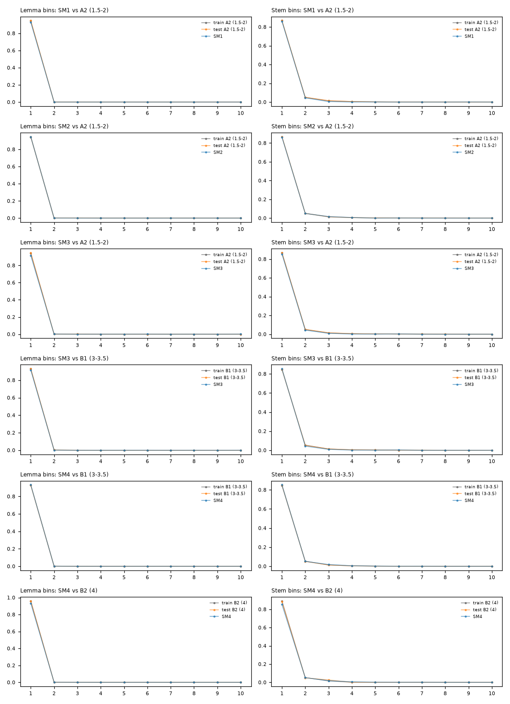

# Vocabulary bins of the SM books: equal count (every bin holds the same number of distinct words)

Mean share of a text's words in each frequency bin (bin 1 = most frequent); lemma and stem bins use the same method.

## SM books only

## Each SM book against the train and test texts of the corresponding level

Six comparisons from the three training levels that the books can match (our labels start at A2, so SM1 has no A1 reference; C1 and C2 have no SM counterpart). Real-Finnish texts per level, A2 (1.5-2): train 342, test 130; B1 (3-3.5): train 673, test 243; B2 (4): train 104, test 48; SM paragraph texts: SM1 8, SM2 6, SM3 12, SM4 12.

